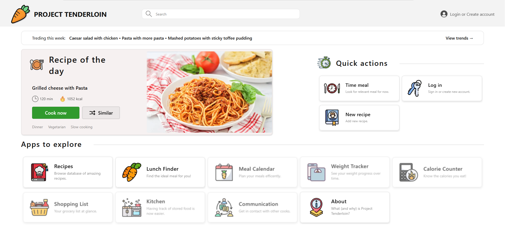
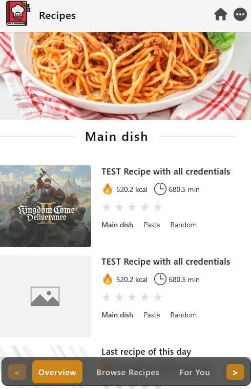

# Project Tenderloin 

Project Tenderloin is an [Next.js](https://nextjs.org) project that aims to ehnance user experience and make your life easier regarding food and meals topic.

## Screenshots

# Availability

Latest version is always available at Vercel:
- [https://project-tenderloin.vercel.app/](https://project-tenderloin.vercel.app/)

# Status 

This project is still far from finished! Not for everyday use. See:
- [Issues](https://github.com/horsecz/Project-Tenderloin-public/issues)
- [Project Tenderloin/About](https://project-tenderloin.vercel.app/about)

## Contribute

Do you want to contribute to Project Tenderloin? Contact us here:
- [Project Tenderloin/About](https://project-tenderloin.vercel.app/about/contact)

## Supported devices

Any device that has over 4" screen and (any) web browser. For example:
- Mozilla Firefox on Windows 10
- Google Chrome on Fedora Linux
- Safari on any iPhone

### Limits

- Devices with screen from 4.7" to 4.99" may have `slight` issues while using the app with `UI scaling, larger fonts or anything that decreases viewport width/height`.
- Devices with screen from 4" to 4.7" may have `some` issues while using the app with `UI scaling, larger fonts or anything that decreases viewport width/height`.
- Devices with screen below 4" are not supported